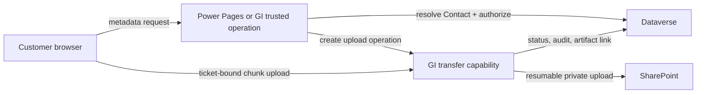

# Architecture Review: GI Portal large-file upload decision path

| Field | Value |
|---|---|
| Status | Draft - requires human acceptance |
| Decision owner | Unknown; assumed joint approval by GI product owner, GI security authority, and Microsoft 365 tenant owner until named otherwise |
| Review date | 2026-10-17 |
| Confidence | Medium - the staged recommendation is well supported by the fixture, but current Microsoft/GCC capability claims were not externally verified in this run |
| Scope | Decide the architecture path for customer large-file uploads from GI Portal to SharePoint without direct customer SharePoint access. Excludes detailed implementation, final service hosting approval, and production support sign-off. Also captures the provided requirement that any reusable analysis or generation toolkit for this work must honor `.gitignore` so ignored paths are excluded from input discovery. |

## Executive decision

**Recommendation:** Approve a bounded proof of concept immediately, and treat a GI-specific transfer capability as the target production architecture only if the proof confirms the identity chain, approved hosting boundary, least-privilege SharePoint access, and resumable upload behavior. Do not approve a shared cross-Planning service in this decision.

**Why now:** The current upload path is already described as unsuitable for required file sizes, and a staged decision reduces the risk of choosing an unsupported or over-privileged integration path.

**Conditions:**

- Unknown -> confirm the data classification, allowed cloud boundary, and retention obligations for uploaded artifacts before production design approval.
- Unknown -> prove that a GI-operated trusted backend can establish the authenticated Contact server-side, recheck Dataverse authorization, and hide SharePoint credentials and upload URLs from the browser.
- Unknown -> prove that the target SharePoint tenant and permission model support resumable large-file transfer with the required sensitivity-label, malware-handling, and audit behavior.
- Assumption -> if no second funded consumer and no shared owner emerge during the proof, keep the first implementation GI-specific.
- Provided fact -> any reusable toolkit or automation used for this decision must honor `.gitignore` so ignored paths are not ingested on reruns.

**Residual risk:** Even with the staged approach, the largest residual risk is a late-discovered platform or boundary limitation in GCC or the target SharePoint tenant that forces redesign after proof work has started.

## Decision drivers and blocking conditions

| Driver | Why it matters | Evidence state |
|---|---|---|
| Customer large-file upload need | The business need exists now, and the current path is already described as unsuitable for required file sizes. | Provided fact |
| No direct SharePoint access for customers | The architecture must preserve a trusted mediation layer and cannot expose tenant credentials or upload URLs. | Provided fact |
| Dataverse project entitlement | Customer authorization already depends on Dataverse Contact and GI Project relationships. | Provided fact |
| Data classification and residency | CEII, export-controlled, personal, or other restricted data would change boundary, control, and retention decisions. | Unknown |
| Power Pages to backend identity chain | The trusted flow depends on securely resolving the authenticated Contact server-side rather than trusting browser input. | Unknown |
| SharePoint tenant and permission behavior | Least-privilege access, sensitivity labels, and upload-session support are prerequisites for the target design. | Unknown |
| Reuse demand beyond GI | Shared-service scope is only justified if other consumers, funding, and governance are confirmed. | Unknown |
| Toolkit discovery honors `.gitignore` | Reusable automation must exclude `.gitignore`-ignored paths from source discovery so ignored artifacts, scratch files, or generated outputs do not become accidental evidence inputs. | Provided fact |
| Decision ownership and acceptance measures | Without named owners and exit criteria, the proof can succeed technically but still fail to get approved. | Unknown |

### Completeness checks

- Passed: problem statement, existing landscape, candidate directions, and major unknown categories are explicitly present in the fixture.
- Passed: security invariants prohibit trusting browser authorization data and prohibit exposing SharePoint access directly.
- Failed or missing: named decision owner, measurable success criteria, file-size profile, data classification, approved hosting boundary, RTO/RPO, SLO, and cost owner.
- Result: the review is not blocked because the user explicitly authorized documented assumptions; however, production commitment remains conditional on the blocking proofs below.

### Blocking decisions

1. Confirm artifact data classification, residency, and retention rules - **Owner:** GI information security / records management - **Needed by:** before production architecture approval
2. Confirm target SharePoint tenant boundary, allowed application permission model, and label behavior - **Owner:** Microsoft 365 tenant owner - **Needed by:** before proof exit
3. Confirm the supported Power Pages or GI backend mechanism that resolves Contact identity server-side - **Owner:** Dynamics/Power Pages platform owner - **Needed by:** before proof build
4. Confirm the approved hosting environment and network path for the transfer capability - **Owner:** cloud platform owner - **Needed by:** before proof build
5. Name the service owner, support owner, and funding owner for the production capability - **Owner:** GI product leadership - **Needed by:** before production go-live

## Recommended architecture

Assumption: an approved GI-operated transfer capability can run in a trusted backend boundary that is separate from the browser and can call Dataverse and SharePoint without exposing service credentials to customers.

Assumption: Dataverse remains the authoritative source for Contact-to-project entitlement and upload request metadata, while SharePoint becomes the authoritative store for the completed artifact binary and its document lifecycle after commit.

The recommended end state is a two-stage path:

1. **Stage 1 - bounded proof of concept**
   - Implement only enough capability to prove server-side Contact resolution, Dataverse authorization revalidation, ticket minting, resumable chunk handling, SharePoint write behavior, and post-upload verification.
   - Keep all Microsoft capability claims unverified until demonstrated in the target GCC and SharePoint boundary.
2. **Stage 2 - GI-specific production transfer capability**
   - Browser sends project selection, document type, filename, size, and checksum intent to a trusted GI operation.
   - Trusted GI operation resolves the authenticated Contact from the server-side session, verifies entitlement in Dataverse, and creates an upload operation record.
   - Transfer capability mints a short-lived ticket bound to operation ID, Contact, project, document type, file constraints, audience, and expiration.
   - Browser uploads chunks to the transfer capability, never directly to SharePoint.
   - Transfer capability coordinates resumable transfer to SharePoint, verifies completion and checksum, revalidates authorization before final commit, records audit events, and returns an artifact reference to the GI system.
   - Malware scan, content validation, and quarantine status gate project linkage or customer-visible completion.

### Guardrails

- Provided fact -> browser-supplied Contact IDs, project IDs, or authorization decisions are never trusted.
- Security invariant -> application authentication is not sufficient for customer authorization; Dataverse entitlement must be checked server-side for each upload operation and before finalize.
- Security invariant -> upload tickets must be short-lived, audience-bound, operation-bound, project-bound, file-constrained, and replay-resistant.
- Security invariant -> SharePoint upload URLs, application credentials, and tenant internals are never exposed to the browser.
- Assumption -> artifact completion is not marked successful until malware handling, integrity validation, and authorization revalidation succeed.
- Reliability requirement -> finalize, cancel, and cleanup operations must be idempotent so interrupted clients or retries do not create duplicate artifacts.
- Provided fact -> any reusable toolkit that generates reviews, diagrams, contracts, or other outputs for this decision must honor `.gitignore` during discovery and analysis.

## Options and weighted comparison

Scoring: 1 = poor, 3 = acceptable, 5 = strong. Weights total 100%.

| Option | Summary | Weighted score | Disposition |
|---|---|---:|---|
| Minimal change to current portal upload path | Try to keep the existing upload path and improve limits or ergonomics within current portal capabilities. | 1.90/5 | Reject as target state; retain only as a proof branch if it can satisfy all controls without sending file bytes through unsuitable services |
| GI-specific transfer capability | Build a GI-owned transfer service that keeps Dataverse as the authorization system and mediates all artifact bytes. | 3.75/5 | Recommend as target production architecture after proof exit |
| Shared Artifact Management service | Build the same technical pattern as a Planning-wide shared capability from the start. | 2.95/5 | Retain as future evolution only if reuse demand, governance, and funding are demonstrated |
| Defer production commitment pending bounded proof | Time-box a proof for identity, boundary, permission, and resumable upload behavior before selecting a production design. | 3.50/5 | Recommend as the immediate next step and release gate |

### Detailed scoring

| Criterion | Weight | Minimal change | GI-specific transfer | Shared Artifact Management | Defer pending bounded proof |
|---|---:|---|---|---|---|
| Security and compliance fit | 25% | **1** - the current path is already described as unsuitable, and there is no evidence it can hide SharePoint access while meeting future classification controls | **4** - trusted mediation, ticket scope, and server-side entitlement fit the stated invariants, though tenant and permission proofs are still missing | **4** - same technical control potential as GI-specific, but broader scope adds more trust boundaries and approval surfaces | **3** - does not itself solve security, but it limits irreversible commitment until the controls are proven |
| Delivery feasibility under current unknowns | 20% | **2** - smallest change on paper, but it depends on unsupported assumptions about current portal limits | **4** - aligns to the current landscape and can be delivered once the proof validates the boundary | **2** - feasible technically, but current evidence does not show funded consumers, governance, or a stable shared contract | **5** - directly addresses the largest unknowns with the least irreversible scope |
| Integration fit with current GI landscape | 15% | **2** - would strain the existing portal path and keep upload concerns coupled to a path already considered inadequate | **4** - preserves Dataverse authorization and adds a clear mediation contract | **3** - contract could be clean, but it introduces broader compatibility and versioning demands immediately | **3** - proof can reuse the intended contract shape, but it does not complete the full integration |
| Large-file reliability and scale potential | 15% | **1** - no evidence that the current path can support resumable chunks, recovery, or higher throughput | **4** - a dedicated transfer capability can implement chunking, retries, cleanup, and backpressure | **4** - same technical potential as GI-specific if properly funded and operated | **2** - validates behavior but is not yet a production scale posture |
| Operability and supportability | 10% | **2** - operational signals remain buried in the existing portal path and may be hard to isolate | **3** - adds a new service to operate, but ownership can stay close to GI | **2** - adds a service plus cross-team support and governance overhead before there is evidence the organization can sustain it | **3** - proof can produce telemetry and runbooks, but it is intentionally incomplete |
| Cost and governance efficiency | 15% | **4** - lowest immediate build cost if it worked, but hidden rework risk is high | **3** - moderate build and run cost with direct GI ownership and simpler governance | **2** - highest coordination and standing-cost burden without proven demand | **4** - controls spend by buying down the most expensive unknowns first |
| **Total** | **100%** | **1.90/5** | **3.75/5** | **2.95/5** | **3.50/5** |

### Option rationale

- **Minimal change** is intentionally retained in the comparison because simplicity matters, but the fixture already says the current path is not suitable for required sizes and does not prove the security boundary.
- **GI-specific transfer** scores best because it isolates byte transfer into a trusted boundary while reusing the existing authorization system of record.
- **Shared Artifact Management** is materially different from GI-specific because it requires broader contract stability, multi-tenant governance, funding, and shared operations, none of which are evidenced here.
- **Defer pending bounded proof** is recommended as an immediate gate because several time-sensitive Microsoft and environment-specific claims are still unverified in this run.

## Prioritized findings and risks

| ID | Severity | Finding | Required action | Owner |
|---|---|---|---|---|
| PROBLEM-FRAMING-001 | High | Decision owner, success measures, and proof exit criteria are not named. | Name accountable approvers and go/no-go criteria before proof start. | GI product leadership |
| SECURITY-001 | High | Data classification, hosting boundary, SharePoint permission scope, and tenant behavior are unverified. | Run a boundary and least-privilege proof in the target environment. | Security architect + M365 owner |
| SECURITY-002 | High | Ticket abuse controls are described conceptually but not yet specified or demonstrated. | Define ticket claims, expiry, replay resistance, and revocation semantics before build. | Application security owner |
| DATA-001 | High | Retention, deletion, quarantine, and system-of-record decisions for artifact binaries are unresolved. | Approve data lifecycle and records rules before production design. | Data steward / records owner |
| INTEGRATION-001 | High | Provider contracts, error semantics, and idempotency across GI, Dataverse, and SharePoint are not defined. | Produce and approve contracts before implementation. | Integration owner |
| RELIABILITY-001 | Medium | Resumability, abandoned-session cleanup, and recovery objectives are not quantified. | Define SLO, RTO, RPO, and cleanup behavior; test them in proof. | Service owner |
| OPERABILITY-001 | Medium | Production owner, alerting, dashboards, and support handoff are missing. | Establish ownership and minimum telemetry before go-live. | Service owner |
| COST-SUSTAINABILITY-001 | Medium | Cost drivers and funding are unquantified, and shared-service allocation is unsupported. | Produce an assumption-based cost model after demand is confirmed. | Product owner + finance |
| SIMPLICITY-COUPLING-001 | Medium | A shared service would add coupling and governance without proven consumers. | Keep the first implementation GI-specific unless reuse evidence emerges. | Architecture owner |
| SIMPLICITY-COUPLING-002 | Low | Reusable toolkit boundaries do not yet explicitly honor `.gitignore` during discovery scope evaluation. | Make `.gitignore` a default exclusion source for toolkit discovery. | Toolkit owner / architecture owner |

### Finding details

#### PROBLEM-FRAMING-001

- **Skill:** problem-framing v1.1.0
- **Severity:** high
- **Status:** open
- **Assertion:** Provided context does not identify a single decision owner, measurable success criteria, or the priority threshold that separates proof success from production approval.
- **Evidence:** E-006, E-014, E-015
- **Assumptions and remaining uncertainty:** Assume GI product leadership can convene the approving authorities; this may be false if Microsoft 365 or GCC governance is external to GI.
- **Impact:** Funding, shared-service scope, and production approval can stall even if the proof is technically successful.
- **Recommendation and tradeoffs:** Publish proof goals, mandatory exit criteria, and final approvers before work starts. This adds a short governance step but avoids ambiguous outcomes.
- **Confidence:** high - the omission is explicit in the fixture.
- **Verification steps and owner:** Record named approvers and pass/fail criteria in the project charter or decision log. Owner: GI product leadership.

#### SECURITY-001

- **Skill:** security v1.1.0
- **Severity:** high
- **Status:** open
- **Assertion:** The target data classification, allowed hosting boundary, SharePoint tenant type, and least-privilege permission behavior are not confirmed.
- **Evidence:** E-003, E-007, E-008, E-010, E-011, E-018
- **Assumptions and remaining uncertainty:** Assume the final boundary can legally store the artifacts and that an application identity can be constrained enough for the required writes; both assumptions require proof.
- **Impact:** A wrong assumption here can make the recommended design non-compliant or impossible to approve.
- **Recommendation and tradeoffs:** Run a proof in the real boundary and document what identity, permissions, labels, and storage path are actually allowed. This delays production commitment but avoids rework.
- **Confidence:** high - these are explicit unknowns and time-sensitive platform claims.
- **Verification steps and owner:** Validate with tenant admins and security architecture; capture the exact permission set, storage location, and label behavior in the proof record. Owner: security architect and M365 owner.

#### SECURITY-002

- **Skill:** security v1.1.0
- **Severity:** high
- **Status:** open
- **Assertion:** The upload-ticket control is only a concept today; the design does not yet prove claim set, signature method, expiry, replay handling, revocation, or rate limiting.
- **Evidence:** E-004, E-013
- **Assumptions and remaining uncertainty:** Assume the transfer capability can validate tickets online for every chunk or otherwise detect replay safely.
- **Impact:** Weak ticket controls would let an authenticated but unauthorized client reuse a ticket, exceed approved file constraints, or automate abusive upload patterns.
- **Recommendation and tradeoffs:** Specify the ticket contract before implementation and test replay, expiration, and size/type constraint enforcement during the proof. Stronger controls add token-validation complexity but are necessary.
- **Confidence:** medium - the required control properties are clear, but the exact mechanism is still undecided.
- **Verification steps and owner:** Threat-model the ticket flow, implement negative tests for replay and tampering, and record expected failure responses. Owner: application security owner.

#### DATA-001

- **Skill:** data v1.1.0
- **Severity:** high
- **Status:** open
- **Assertion:** Artifact lifecycle governance is incomplete: binary system of record, quarantine state, retention, replacement, deletion proof, and metadata lineage are not yet approved.
- **Evidence:** E-003, E-012, E-017
- **Assumptions and remaining uncertainty:** Assume SharePoint can be the binary system of record while Dataverse keeps entitlement and linkage metadata; this split may not satisfy downstream records or audit needs.
- **Impact:** Unclear lifecycle rules create uncontrolled copies, uncertain deletion behavior, and audit gaps.
- **Recommendation and tradeoffs:** Approve a lifecycle matrix covering creation, quarantine, release, replacement, deletion, and audit evidence before production design. This adds governance work but prevents ambiguous records handling.
- **Confidence:** high - the fixture explicitly lists these items as open questions.
- **Verification steps and owner:** Produce a data lifecycle decision table signed by records management, security, and product owners. Owner: data steward / records owner.

#### INTEGRATION-001

- **Skill:** integration v1.1.0
- **Severity:** high
- **Status:** open
- **Assertion:** The architecture boundary is reasonable, but no approved contracts define request shape, correlation IDs, error semantics, idempotency, or retry behavior across GI, Dataverse, the transfer service, and SharePoint.
- **Evidence:** E-004, E-009, E-010, E-013, E-014
- **Assumptions and remaining uncertainty:** Assume the GI backend can own a stable contract and that compatibility only needs to support one browser client initially.
- **Impact:** Undefined contracts increase the chance of duplicate uploads, poor diagnostics, and brittle coupling to platform details.
- **Recommendation and tradeoffs:** Define provider-owned contracts for create-session, upload-chunk, finalize, cancel, and status flows before implementation. This adds early design effort but reduces production ambiguity.
- **Confidence:** high - contract details are absent from the provided context.
- **Verification steps and owner:** Publish contract definitions, error catalog, retry rules, and idempotency keys; review them with all providers and consumers. Owner: integration owner.

#### RELIABILITY-001

- **Skill:** reliability v1.1.0
- **Severity:** medium
- **Status:** open
- **Assertion:** Recovery objectives, acceptable degradation, retry behavior, and abandoned-session cleanup requirements are not defined.
- **Evidence:** E-006, E-014
- **Assumptions and remaining uncertainty:** Assume resumable upload and idempotent finalize are mandatory because file size and customer network interruptions are likely.
- **Impact:** Without explicit reliability targets, the proof may validate a happy path but still miss operationally important failures.
- **Recommendation and tradeoffs:** Define SLO, RTO, RPO, timeout budgets, retry caps, and cleanup windows, then test browser interruption, service restart, and partial SharePoint failure scenarios.
- **Confidence:** medium - the need is clear, but target values depend on business tolerance that is not provided.
- **Verification steps and owner:** Run recovery drills in the proof and capture measured pass/fail results. Owner: service owner.

#### OPERABILITY-001

- **Skill:** operability v1.1.0
- **Severity:** medium
- **Status:** open
- **Assertion:** No owner, on-call model, dashboards, actionable alerts, or audit review process is defined for the proposed transfer capability.
- **Evidence:** E-014
- **Assumptions and remaining uncertainty:** Assume GI can operate one additional service with basic logs, metrics, traces, and audit events.
- **Impact:** A technically sound design can still fail in production if incidents, cleanup, and customer support are manual or ownerless.
- **Recommendation and tradeoffs:** Assign a named service owner and define the minimum telemetry set during the proof so production work starts with an operable baseline.
- **Confidence:** high - these items are absent from the context.
- **Verification steps and owner:** Review dashboards, alert routes, synthetic checks, and runbooks before go-live. Owner: service owner.

#### COST-SUSTAINABILITY-001

- **Skill:** cost-sustainability v1.1.0
- **Severity:** medium
- **Status:** open
- **Assertion:** Transfer, storage, scanning, and support costs cannot be meaningfully estimated because demand, retention, and pricing assumptions are missing, and shared-service allocation has no confirmed funders.
- **Evidence:** E-006, E-012, E-015, E-018
- **Assumptions and remaining uncertainty:** Assume GI can fund a scoped service if the proof succeeds; this is weaker for a shared service.
- **Impact:** Shared-service ambitions can create standing cost without a sponsor, while even GI-only costs can surprise the program if storage growth or scanning is high.
- **Recommendation and tradeoffs:** Produce an assumption-based cost model after the proof confirms feasible architecture and demand. Waiting reduces false precision but delays budget confidence.
- **Confidence:** medium - dominant cost drivers are clear, but quantities are not.
- **Verification steps and owner:** Estimate normal and peak unit costs using proof measurements, retention rules, and official pricing at the time of budgeting. Owner: product owner and finance.

#### SIMPLICITY-COUPLING-001

- **Skill:** simplicity-coupling v1.1.0
- **Severity:** medium
- **Status:** open
- **Assertion:** Starting with a shared Artifact Management service would add cross-team governance, contract stability, and funding coupling without evidence that other consumers need it now.
- **Evidence:** E-015
- **Assumptions and remaining uncertainty:** Assume one GI use case is the only committed consumer today.
- **Impact:** Premature sharing increases delivery risk and long-term coordination cost before the architecture has proven itself in one bounded domain.
- **Recommendation and tradeoffs:** Keep the first deployable capability GI-specific and design the contracts so they can be generalized later if real reuse appears.
- **Confidence:** high - the fixture explicitly says broader reuse evidence is missing.
- **Verification steps and owner:** Require at least one additional funded consumer, shared owner, and approved governance model before broadening scope. Owner: architecture owner.

#### SIMPLICITY-COUPLING-002

- **Skill:** simplicity-coupling v1.1.0
- **Severity:** low
- **Status:** open
- **Assertion:** The requirement to reuse this work as a toolkit introduces a coupling risk if discovery does not honor `.gitignore` and therefore includes ignored generated artifacts or scratch paths.
- **Evidence:** E-019
- **Assumptions and remaining uncertainty:** Assume the future toolkit will scan repository content or configured directories when assembling evidence. The exact precedence between `.gitignore`, explicit include paths, and additional ignore rules is not yet defined.
- **Impact:** Ignored generated files or scratch artifacts can create circular evidence, duplicate findings, noisy diffs, and repository-specific behavior that reduces toolkit reuse.
- **Recommendation and tradeoffs:** Make `.gitignore` an explicit default guardrail for any reusable toolkit, with optional additional ignores when needed. This adds a small amount of path-filtering logic but aligns behavior with repository expectations and improves portability.
- **Confidence:** high - the requirement was directly provided by the user in this run.
- **Verification steps and owner:** Demonstrate two consecutive runs where ignored files or directories exist and are excluded from the second run's evidence set because they match `.gitignore`. Owner: toolkit owner / architecture owner.

## Verification and delivery plan

| Gate | Proof required | Method | Exit criterion | Owner |
|---|---|---|---|---|
| Identity chain proof | Server-side Contact resolution and Dataverse entitlement revalidation work without trusting browser identity data | Build a proof flow in the target Power Pages/GI boundary and execute positive and negative authorization tests | Unauthorized project selection is rejected server-side; audit shows resolved Contact and decision | Dynamics/Power Pages owner |
| SharePoint boundary proof | Target tenant and app permission model support the required write path without exposing upload URLs to the browser | Test the candidate app identity and transfer pattern in the target tenant | Approved permission scope, storage location, and URL-hiding behavior are documented and signed off | M365 tenant owner |
| Resumable upload proof | Chunk upload, interruption recovery, and finalize idempotency work for representative large files | Run uploads with forced network drops, duplicate finalize calls, and partial backend failures | Upload resumes within defined limits; duplicate finalize does not create duplicate artifacts | Service owner |
| Security control proof | Ticket expiry, audience binding, replay resistance, checksum enforcement, malware workflow, and file-type validation work as designed | Threat modeling plus automated negative tests | Replay, tampering, over-size, wrong-type, and expired-ticket cases fail safely with auditable events | Application security owner |
| Data governance approval | Retention, deletion, quarantine release, replacement, and evidence of deletion are approved | Review lifecycle matrix with records, security, and product owners | Signed lifecycle matrix exists before production implementation | Data steward |
| Operations readiness | Monitoring, alerting, runbooks, cleanup jobs, and support ownership are defined | Review telemetry dashboards and rehearse an incident | Named owner, actionable alerts, and tested recovery steps exist before go-live | Service owner |
| Cost and scope decision | Production cost and service scope are acceptable | Use proof measurements plus current pricing during budgeting | GI-specific funding is approved; shared scope requires an additional funded consumer and owner | Product owner |
| Toolkit reuse guardrail | `.gitignore`-ignored paths are excluded from discovery so reusable automation does not ingest ignored artifacts | Run the same analysis twice with ignored outputs present from the first run | Second run input set excludes `.gitignore`-matched paths and does not cite ignored generated artifacts as source evidence | Toolkit owner |

## Evidence ledger and citations

### Facts, assumptions, and unknowns

| ID | Statement | Provenance | State | Decision impact |
|---|---|---|---|---|
| E-001 | External customers need to upload large engineering artifacts through GI Portal, and the existing upload path is not suitable for required file sizes. | Fixture: `evals/gi-portal-large-file-upload.md`, Problem section | Provided fact | High |
| E-002 | The portal is implemented with Power Pages; portal users map to Dataverse Contacts; Dataverse stores project-upload entitlement; Dynamics 365 and Dataverse run in Microsoft GCC. | Fixture: Existing landscape section | Provided fact | High |
| E-003 | SharePoint is the intended artifact destination, but the tenant type and exact storage boundary are not confirmed. | Fixture: Existing landscape section | Provided fact | High |
| E-004 | A prior candidate flow proposes that the browser sends metadata to a trusted GI operation and uploads chunks using a scoped ticket while SharePoint details stay hidden. | Fixture: Proposed flow from the prior discussion | Observed evidence | High |
| E-005 | The fixture explicitly marks Microsoft capability statements such as Graph upload sessions, GCC identity behavior, and Dataverse plugin identity as historical claims requiring current verification. | Fixture: Historical claims requiring current verification | Provided fact | High |
| E-006 | Required maximum and typical file sizes, concurrency, aggregate volume, and upload frequency are not provided. | Fixture: Known open questions | Unknown | High |
| E-007 | Data classification, including whether artifacts contain CEII, personal, export-controlled, or other restricted data, is not provided. | Fixture: Known open questions | Unknown | High |
| E-008 | The approved hosting environment and network path for Artifact Management are not provided. | Fixture: Known open questions | Unknown | High |
| E-009 | The secure mechanism that establishes the Contact server-side from Power Pages is not provided. | Fixture: Known open questions | Unknown | High |
| E-010 | The supported Dynamics/Dataverse workload identity and outbound-call pattern in this GCC environment are not provided. | Fixture: Known open questions | Unknown | High |
| E-011 | SharePoint cloud, permission model, sensitivity-label behavior, and upload-session support are not provided. | Fixture: Known open questions | Unknown | High |
| E-012 | Malware scanning, content validation, checksum, quarantine, retention, replacement, and deletion requirements are not provided. | Fixture: Known open questions | Unknown | High |
| E-013 | Upload-ticket claims, signing, expiration, replay protection, revocation, and rate limits are not provided. | Fixture: Known open questions | Unknown | High |
| E-014 | Recovery behavior, audit expectations, support model, SLO, RTO, RPO, cost ownership, and operational ownership are not provided. | Fixture: Known open questions | Unknown | High |
| E-015 | Evidence that other Planning applications need and will fund a shared service is not provided. | Fixture: Known open questions | Unknown | Medium |
| E-016 | An approved GI-operated transfer capability can be deployed in a trusted boundary that can call Dataverse and SharePoint without exposing credentials to customers. | Review assumption for option comparison | Assumption | High |
| E-017 | Dataverse remains authoritative for entitlement and upload metadata, while SharePoint becomes authoritative for committed artifact binaries. | Review assumption for recommended architecture | Assumption | Medium |
| E-018 | This review did not externally verify time-sensitive Microsoft platform claims because current web verification was unavailable in this run; those claims remain unverified proof gates. | Review execution limitation | Observed evidence | High |
| E-019 | The user clarified that the reusable toolkit should honor `.gitignore` when deciding which paths to analyze. | User message on 2026-10-17 | Provided fact | Medium |

### External sources

No external sources were verified in this run. Limitation: current official Microsoft documentation for GCC identity paths, SharePoint upload-session behavior, and permission scope could not be consulted from this surface, so all time-sensitive platform claims remain unverified and are converted into proof-of-concept exit criteria.

## Candidate ADR

- **Title:** Stage large-file upload delivery with a bounded proof first, then implement a GI-specific transfer capability if proofs pass
- **Status:** Proposed
- **Context:** GI Portal needs customer large-file uploads into SharePoint without granting customers direct SharePoint access, but the target identity chain, data boundary, and SharePoint capabilities are not yet verified.
- **Decision:** Authorize a bounded proof immediately. If the proof confirms the target boundary, server-side Contact resolution, least-privilege SharePoint access, resumable transfer, and lifecycle controls, implement a GI-specific transfer capability. Do not start with a shared cross-Planning service unless additional funded consumers and governance are approved.
- **Consequences:** Positive - reduces commitment risk, keeps authorization anchored in Dataverse, preserves a strong trust boundary around SharePoint, and keeps any reusable toolkit aligned with repository ignore semantics so ignored artifacts are not recursively analyzed. Negative - adds an up-front proof phase, requires explicit `.gitignore` handling in toolkit automation, and defers any shared-service ambition.
- **Validation gates:** Identity chain proof, SharePoint boundary proof, ticket-control proof, lifecycle approval, operations readiness, and funding approval
- **Decision owner:** Unknown; assumed joint approval by GI product leadership, security, and M365 ownership until named otherwise

Decision status: requires human acceptance.
