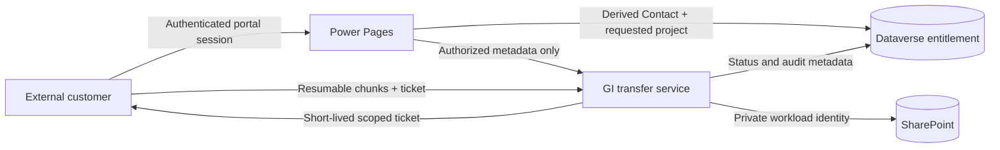

# Architecture Review: GI Portal Large-File Upload

| Field | Value |
|---|---|
| Status | Draft — requires human acceptance |
| Decision owner | GI product owner and enterprise architecture review board |
| Review date | 2026-10-17 |
| Confidence | Medium — the pattern is sound, but cloud, identity, classification, and load assumptions remain unverified |
| Scope | Customer upload from Power Pages to SharePoint; excludes downstream document processing and records retention design |

## Executive decision

**Recommendation:** Prove, then implement a GI-owned transfer service that authorizes each upload against Dataverse and streams resumable chunks to SharePoint. Do not send large-file bytes through Dataverse or Power Automate, expose SharePoint locations to the browser, or create a shared enterprise service until reuse and ownership are demonstrated.

**Why now:** The existing portal path does not meet the stated large-file need, while direct browser access to SharePoint would violate the supplied trust-boundary requirements.

**Conditions:**

- Confirm artifact classification, residency rules, SharePoint cloud boundary, and the permitted GCC-to-SharePoint identity path.
- Prove least-privilege SharePoint access, entitlement enforcement, resumability, replay resistance, malware handling, and abandoned-session cleanup under representative load.
- Set measurable file-size, concurrency, availability, recovery, and support targets.

**Residual risk:** Cross-cloud identity or data-handling constraints may invalidate the proposed service boundary and force the storage or hosting design to change.

## Decision drivers and blockers

| Driver | Why it matters | Evidence state |
|---|---|---|
| No direct SharePoint access | Protects internal locations and credentials from external customers | Provided fact |
| Dataverse entitlement | Project and document-type authorization must remain authoritative | Provided fact |
| Large, interruption-prone transfers | Requires chunking, resume, idempotency, and cleanup | Inference; size profile unknown |
| GCC and SharePoint boundary | Determines viable identity, network, compliance, and API patterns | Unknown |
| Narrow delivery scope | Avoids premature shared-service governance and coupling | Inference |

### Blocking decisions

1. Classify the artifacts and determine residency/export/CEII obligations — **Owner:** data owner and security — **Needed by:** architecture acceptance.
2. Confirm maximum and typical file size, daily volume, concurrency, and client-network conditions — **Owner:** product owner — **Needed by:** proof-of-concept design.
3. Confirm the Power Pages, Dataverse, service-hosting, Entra, and SharePoint cloud boundaries — **Owner:** cloud/platform architect — **Needed by:** identity design.
4. Approve the server-side identity chain and least-privilege SharePoint permissions — **Owner:** identity and SharePoint administrators — **Needed by:** security review.
5. Define malware, quarantine, replacement, retention, and support ownership — **Owner:** security operations and service owner — **Needed by:** production readiness.

## Recommended architecture

The browser initiates an upload but never establishes authority. A trusted portal-side operation derives the authenticated Contact, checks the Contact-to-project entitlement in Dataverse, and requests an upload transaction. The GI transfer service issues a short-lived, audience- and project-bound ticket. The browser sends resumable chunks to that service, which uses a private workload identity to write to SharePoint. The service owns integrity checks, idempotency, status, audit, cancellation, expiry, and cleanup.

### Guardrails

- Never trust a browser-supplied Contact ID, project authorization, destination path, or document classification.
- Bind tickets to user/session context, transaction, project, filename/type, maximum size, audience, expiry, and a replay-control mechanism.
- Keep SharePoint URLs, upload sessions, and service credentials out of the browser.
- Validate content type and size server-side; scan or quarantine before marking an artifact complete.
- Make create, append, complete, cancel, and retry behavior idempotent and observable.
- Deny safely when Dataverse or identity dependencies are unavailable; do not reuse stale authorization indefinitely.

## Options and comparison

Scoring: 1 = poor, 3 = acceptable, 5 = strong. Scores are provisional because load, classification, and cloud-boundary evidence is incomplete. Weights total 100%.

| Option | Summary | Weighted score | Disposition |
|---|---|---:|---|
| Improve native portal path | Retain the existing path if verified limits meet the actual workload | 2.50/5 | Retain only as a low-volume fallback |
| GI-owned transfer service | Dedicated authorization and resumable transfer boundary for GI | 4.00/5 | Recommended after proof gates |
| Shared artifact service | Common capability for multiple applications | 3.05/5 | Defer until consumers and governance exist |
| Time-boxed proof only | Validate blockers without committing to production topology | 4.20/5 | Immediate next step, not the end-state |

| Criterion | Weight | Native portal | GI service | Shared service | Proof only |
|---|---:|---:|---:|---:|---:|
| Security and compliance fit | 25% | 2 | 4 | 4 | 5 |
| Delivery feasibility | 20% | 3 | 4 | 3 | 5 |
| Reliability and recovery | 20% | 2 | 4 | 4 | 4 |
| Ownership and operability | 15% | 4 | 4 | 2 | 4 |
| Cost sustainability | 10% | 3 | 3 | 2 | 4 |
| Scale and performance | 10% | 2 | 5 | 5 | 2 |

The proof ranks highest because it reduces decision uncertainty; it is a gate, not a production alternative. Among end-state designs, the GI-owned service best balances security, delivery scope, and operational ownership. A shared service becomes attractive only when multiple funded consumers can use one contract and operating model.

## Prioritized findings and risks

| ID | Severity | Finding | Required action | Owner |
|---|---|---|---|---|
| PROBLEM-FRAMING-ID-001 | High | Classification, load profile, cloud boundary, and ownership are unresolved; they can change the option set | Close the five blocking decisions before acceptance | Product owner |
| SECURITY-ID-002 | Critical | Browser input could become an authorization bypass if Contact, project, destination, or ticket scope is trusted | Derive identity server-side and test cross-project, replay, expiry, and tampering cases | Security architect |
| INTEGRATION-ID-003 | High | The GCC-to-SharePoint identity and permission path is unproven | Demonstrate token acquisition and least-privilege upload in the target tenants | Cloud architect |
| RELIABILITY-ID-004 | High | Interrupted uploads can leave corrupt or orphaned artifacts | Prove resume, idempotency, integrity, cancellation, and cleanup | Service owner |
| OPERABILITY-ID-005 | Medium | Support, telemetry, incident ownership, and service targets are undefined | Establish SLOs, dashboards, alerts, runbooks, and ownership | Operations owner |
| SIMPLICITY-COUPLING-ID-006 | Medium | A shared service would add governance and dependency cost without evidence of reuse | Require named consumers, funding, and a common contract before generalizing | Enterprise architect |

All findings use skill version 1.1.0. Confidence is high for the trust-boundary and recovery findings because they follow directly from the supplied requirements; confidence is medium for platform feasibility because current target-environment evidence is missing.

## Verification and delivery plan

| Gate | Proof required | Method | Exit criterion | Owner |
|---|---|---|---|---|
| Workload envelope | Size, volume, concurrency, and network profile | Production telemetry and stakeholder sign-off | Test envelope and SLOs approved | Product owner |
| Data handling | Classification, residency, scanning, retention | Security/privacy records review | Written handling decision | Data owner |
| Identity and authorization | Server-derived Contact and current Dataverse entitlement | Target-tenant prototype and negative tests | No browser-controlled authorization; fail-closed behavior verified | Security architect |
| SharePoint access | Supported upload mechanism and least privilege | Target-tenant prototype using proposed workload identity | Upload succeeds only in the approved site/container and path | SharePoint admin |
| Transfer reliability | Resume, duplicate chunks, corruption, timeout, cancel, and cleanup | Fault-injection test at maximum file size and concurrency | Integrity preserved; bounded recovery and cleanup meet SLO | Engineering lead |
| Production operations | Monitoring, audit, alerting, capacity, cost, and support | Operational-readiness review | Named owner accepts runbook and SLO | Service owner |

Build no production service until the data-handling and identity gates pass. After those gates, deliver a thin vertical slice before adding generalized shared-service capabilities.

## Evidence ledger and citations

### Facts, assumptions, and unknowns

| ID | Statement | Provenance | State | Decision impact |
|---|---|---|---|---|
| E-001 | Customers upload large engineering artifacts through GI Portal to SharePoint | Evaluation fixture | Provided fact | Defines the workflow |
| E-002 | Portal users map to Dataverse Contacts and entitlement is stored in Dataverse | Evaluation fixture | Provided fact | Makes Dataverse the authorization source |
| E-003 | SharePoint URLs and service credentials must not reach the browser | Evaluation fixture | Provided fact | Requires a mediation boundary |
| E-004 | Dataverse and Power Platform operate in GCC | Evaluation fixture | Provided fact | Makes sovereign-cloud compatibility decision-critical |
| E-005 | Large bytes should bypass Dataverse and Power Automate | Prior discussion | Assumption pending current platform verification | Shapes the data path |
| E-006 | Microsoft Graph or SharePoint upload sessions meet the target workload and cloud boundary | Prior discussion | Unknown | Could change the transfer implementation |
| E-007 | Required classification, maximum size, volume, concurrency, and SLOs | Evaluation fixture | Unknown | Prevents final sizing and acceptance |

### External sources

No external product claim was freshly verified during this review. Before acceptance, validate the current Microsoft documentation and the target tenants for SharePoint upload-session support, permission availability, sovereign-cloud endpoints, Power Pages server-side extensibility, and supported workload-identity patterns. Record source title, publisher, update date, retrieval date, supported claim, and limitation in the accepted revision.

## Candidate ADR

- **Title:** Mediate GI Portal large-file uploads through a GI-owned transfer service
- **Status:** Proposed
- **Context:** External customers need reliable large-file upload to SharePoint without direct SharePoint access. Dataverse holds project entitlement, and the solution spans an unresolved GCC/cloud boundary.
- **Decision:** First run a bounded proof of the data, identity, permission, and transfer gates. If they pass, implement a GI-owned transfer service that revalidates Dataverse entitlement and writes resumable uploads to SharePoint with a private workload identity. Keep file bytes out of Dataverse and Power Automate unless current evidence justifies an exception.
- **Consequences:** The design isolates credentials and large payloads and gives GI clear ownership, but adds a service that must be secured, scaled, monitored, and supported. It deliberately postpones enterprise-wide reuse.
- **Validation gates:** Data handling, workload envelope, target-tenant identity, least-privilege SharePoint access, failure recovery, and operational readiness.
- **Decision owner:** GI product owner with enterprise architecture and security approval.

Decision status: requires human acceptance.
