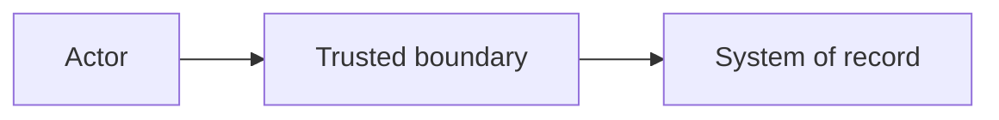

# Architecture Review: <Decision title>

| Field | Value |
|---|---|
| Status | Draft — requires human acceptance |
| Decision owner | <Role or unknown> |
| Review date | <YYYY-MM-DD> |
| Confidence | <Low, medium, or high — brief reason> |
| Scope | <What this review decides and excludes> |

## Executive decision

**Recommendation:** <One clear, conditional decision in one or two sentences.>

**Why now:** <The business or technical outcome this enables.>

**Conditions:**

- <Condition that must be proven or accepted>
- <Condition that must be proven or accepted>

**Residual risk:** <The most important risk that remains after the recommendation.>

## Decision drivers and blockers

| Driver | Why it matters | Evidence state |
|---|---|---|
| <Driver> | <Decision impact> | <Provided, observed, inferred, assumed, verified, or unknown> |

### Blocking decisions

1. <Question or approval> — **Owner:** <role> — **Needed by:** <milestone or unknown>

## Recommended architecture

<Describe boundaries, responsibilities, identity, data movement, and failure behavior.>

### Guardrails

- <Non-negotiable security or reliability rule>

## Options and comparison

Scoring: 1 = poor, 3 = acceptable, 5 = strong. Weights total 100%.

| Option | Summary | Weighted score | Disposition |
|---|---|---:|---|
| <Option> | <Meaningfully different approach> | <0.00>/5 | <Recommend, retain, reject, or defer> |

<Include the detailed criterion-by-option scoring table and short rationale here.>

## Prioritized findings and risks

| ID | Severity | Finding | Required action | Owner |
|---|---|---|---|---|
| <SKILL-ID-NNN> | <Critical–Info> | <Assertion and impact> | <Concrete response> | <Role or unknown> |

<Add full finding details only where the table is insufficient. Preserve skill version, evidence, uncertainty, tradeoffs, confidence, and verification steps.>

## Verification and delivery plan

| Gate | Proof required | Method | Exit criterion | Owner |
|---|---|---|---|---|
| <Gate> | <Claim to prove> | <Test, prototype, or review> | <Observable pass condition> | <Role> |

## Evidence ledger and citations

### Facts, assumptions, and unknowns

| ID | Statement | Provenance | State | Decision impact |
|---|---|---|---|---|
| E-001 | <Material statement> | <Artifact, message, or source> | <Provided fact, observed evidence, inference, assumption, externally verified fact, or unknown> | <Impact> |

### External sources

For each source, record title, URL, publisher, publication/update date when available, retrieval date, supported claim, and limitations. Mark unverified sources clearly.

## Candidate ADR

- **Title:** <Decision title>
- **Status:** Proposed
- **Context:** <Why a decision is required>
- **Decision:** <Recommended option and conditions>
- **Consequences:** <Positive and negative tradeoffs>
- **Validation gates:** <Evidence required before acceptance>
- **Decision owner:** <Role or unknown>

Decision status: requires human acceptance.
